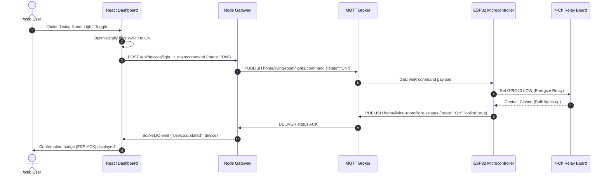

# MQTT Topic & Payload Specification

This document defines the topic hierarchy, Quality of Service (QoS), and JSON payload format for communication between the **IoT Web Gateway Server** and the **ESP32/ESP8266 Microcontrollers**.

---

## 1. Topic Hierarchy Structure

Topics follow the REST-like schema:
`{prefix}/{room}/{device_or_sensor}/{action_or_subtopic}`

Default base prefix: `home`

| Direction | Topic | Purpose | QoS | Payload Example |
| :--- | :--- | :--- | :--- | :--- |
| **Server ➔ ESP32** | `home/{room}/{device}/command` | Command to switch appliance | 1 | `{"state":"ON"}` |
| **ESP32 ➔ Server** | `home/{room}/{device}/status` | State acknowledgement | 1 | `{"state":"ON","online":true}` |
| **ESP32 ➔ Server** | `home/{room}/temperature` | Temperature telemetry | 0 | `{"value":24.5,"unit":"°C"}` |
| **ESP32 ➔ Server** | `home/{room}/humidity` | Humidity telemetry | 0 | `{"value":54.0,"unit":"%"}` |
| **ESP32 ➔ Server** | `home/{room}/motion` | PIR Motion detection | 1 | `{"value":1,"state":"DETECTED"}` |
| **ESP32 ➔ Server** | `home/{room}/light` | LDR ambient light | 0 | `{"value":380,"unit":"lux"}` |
| **ESP32 ➔ Server** | `home/kitchen/gas` | MQ-2 Gas sensor | 1 | `{"value":28,"unit":"ppm"}` |
| **ESP32 ➔ Server** | `home/heartbeat` | Keep-alive heartbeat | 0 | `{"uptime_ms":125000,"rssi":-58}` |

---

## 2. Payload Schemas

### Appliance Command (Server to ESP32)
```json
{
  "state": "ON",
  "timestamp": "2026-10-09T12:00:00.000Z",
  "source": "web_dashboard"
}
```

### Appliance Status Acknowledgement (ESP32 to Server)
```json
{
  "state": "ON",
  "online": true,
  "acknowledged": true
}
```

### Sensor Telemetry (ESP32 to Server)
```json
{
  "value": 24.2,
  "unit": "°C"
}
```

---

## 3. Communication Sequence


